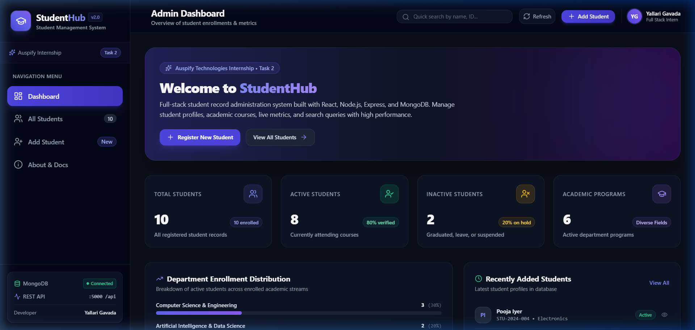
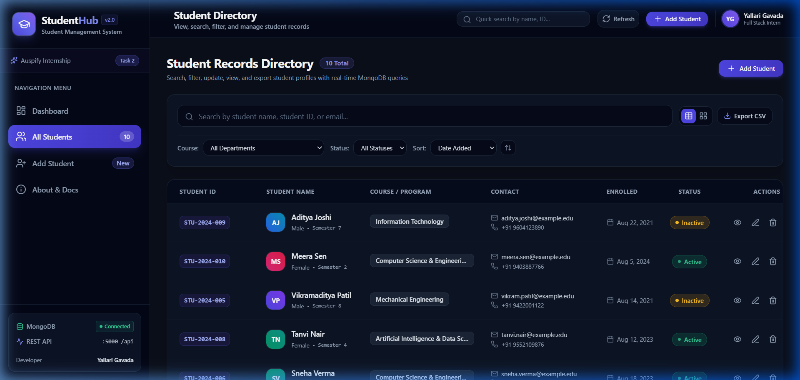
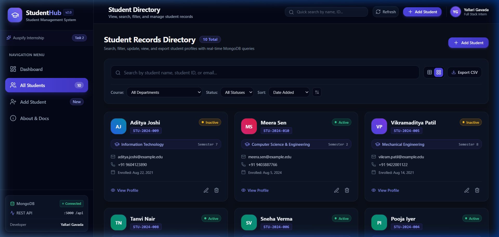
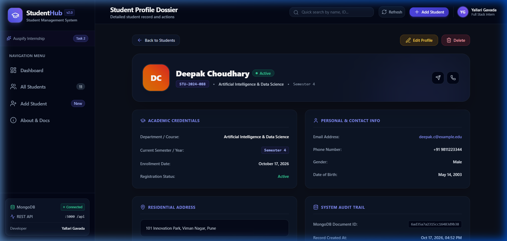
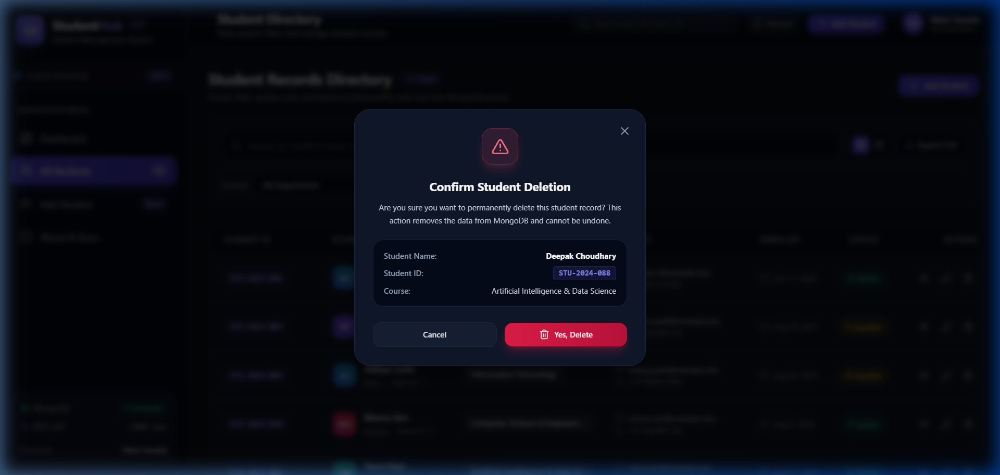
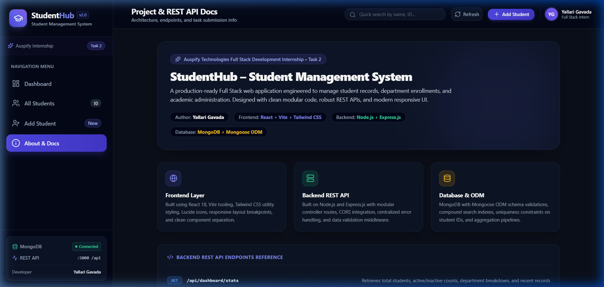

# 🎓 StudentHub – Student Management System

> **Auspify Technologies Full Stack Development Internship — Task 2**  
> Developed by **Yallari Gavada** • Full Stack Developer

[](#frontend)
[](#styling)
[](#backend)
[](#database)
[](#testing)

---

## 📌 Executive Summary

**StudentHub** is a modern, responsive, full-stack Student Management System engineered for academic record administration. It provides seamless CRUD operations, live full-text search, multi-criteria filtering, department analytics, toast notifications, confirmation dialogs, and CSV data export.

The system connects a **React.js + Vite** frontend to an **Express.js + Node.js** REST API backed by a **MongoDB** database with **Mongoose ODM**.

---

## 📸 Application Screenshots

| Dashboard Overview | All Students Directory |
| :---: | :---: |
|  |  |

| Responsive Grid View | Detailed Student Dossier |
| :---: | :---: |
|  |  |

| Safe Deletion Confirmation Modal | REST API Documentation |
| :---: | :---: |
|  |  |

---

## 🚀 Key Features

### 1. Interactive Admin Dashboard
- **Live Metrics**: Total students, active students, inactive students, and active department programs.
- **Department Distribution**: Interactive progress metrics showing student enrollment percentage by academic stream.
- **Gender Ratio Breakdown**: Real-time representation across enrolled students.
- **Recent Registrations**: Quick-access preview cards for the latest 5 registered students.
- **Direct Action Triggers**: Quick registration, directory navigation, and database refresh.

### 2. Comprehensive Student Directory
- **Dual View Modes**: Switch seamlessly between a high-density **Table View** and modern **Grid Cards**.
- **Real-Time Search**: Instant multi-field search across student names, student IDs, and emails.
- **Multi-Criteria Filtering**: Filter by Department/Course and Active/Inactive status.
- **Configurable Pagination**: Page controls with selectable page size (`5`, `10`, `20`, `50`).
- **CSV Data Export**: Download filtered or complete student lists to `.csv` with a single click.
- **Quick Actions**: One-click ID/email clipboard copying, profile inspection, inline editing, and deletion.

### 3. Add & Edit Student Records
- **Fields**: Full Name, Student ID, Email Address, Phone Number, Gender, Date of Birth, Department/Course, Semester/Year, Residential Address, Enrollment Date, and Status.
- **Validation**:
  - Required fields check
  - Regex-verified email format
  - Regex-verified phone format (7-15 digits)
  - Duplicate student ID collision prevention
  - Duplicate email collision prevention
- **Helper Utilities**: One-click "Auto Generate Student ID" helper.

### 4. Student Profile Dossier
- Complete individual profile card displaying academic credentials, personal details, contact actions (`mailto:` and `tel:`), and MongoDB document audit timestamps (`createdAt`, `updatedAt`).

### 5. Safe Deletion Workflow
- Confirmation modal displaying student name, ID, and department before permanently deleting the document from MongoDB.

### 6. Design & Responsiveness
- Premium dark slate theme with vibrant indigo/emerald accents.
- Responsive design verified across mobile (320px, 375px), tablet (768px), laptop (1024px), and desktop (1440px).

---

## 🛠️ Technology Stack

| Layer | Technologies Used |
| :--- | :--- |
| **Frontend** | React 18, Vite 8, Tailwind CSS 3, Lucide React Icons |
| **Backend** | Node.js, Express.js 4, CORS, Morgan logger, Dotenv |
| **Database** | MongoDB (v7/v8), Mongoose ODM 8 |
| **Tools** | Postman, Git & GitHub, PowerShell, REST Client |

---

## 📂 Project Structure

```
student-management-system/
├── client/                     # React Frontend Application
│   ├── src/
│   │   ├── components/
│   │   │   ├── Sidebar.jsx             # Navigation sidebar with DB connection pill
│   │   │   ├── Navbar.jsx              # Header with search & quick actions
│   │   │   ├── StatCard.jsx            # Metric cards with glow accents
│   │   │   ├── StudentTable.jsx        # Table view with avatars & action buttons
│   │   │   ├── StudentCardView.jsx     # Responsive grid view
│   │   │   ├── FilterBar.jsx           # Search, course/status filters, CSV export
│   │   │   ├── Pagination.jsx          # Pagination with per-page controls
│   │   │   ├── StudentModal.jsx        # Edit student modal form
│   │   │   └── DeleteConfirmModal.jsx  # Deletion warning modal
│   │   ├── context/
│   │   │   └── ToastContext.jsx        # Toast notification system
│   │   ├── pages/
│   │   │   ├── DashboardPage.jsx       # Analytics dashboard
│   │   │   ├── StudentsPage.jsx        # Students directory
│   │   │   ├── AddStudentPage.jsx      # Student registration form
│   │   │   ├── StudentDetailsPage.jsx  # Student profile dossier
│   │   │   └── AboutPage.jsx           # Task & API documentation
│   │   ├── services/
│   │   │   └── api.js                  # Frontend API client
│   │   ├── App.jsx                     # Main application container
│   │   ├── main.jsx                    # Application entry point
│   │   └── index.css                   # Tailwind CSS styling & custom scrollbars
│   ├── index.html                      # HTML5 template with SEO meta tags
│   ├── package.json                    # Client dependencies
│   ├── tailwind.config.js              # Tailwind configuration
│   ├── postcss.config.js               # PostCSS configuration
│   └── vite.config.js                  # Vite configuration & proxy
├── server/                     # Express.js REST API
│   ├── config/
│   │   └── db.js                       # Mongoose MongoDB connection
│   ├── controllers/
│   │   ├── studentController.js        # Student CRUD operations
│   │   └── dashboardController.js      # Dashboard aggregation analytics
│   ├── middleware/
│   │   ├── errorHandler.js             # Centralized error handler
│   │   └── validateStudent.js          # Request payload validation
│   ├── models/
│   │   └── Student.js                  # Mongoose Student schema & indexes
│   ├── routes/
│   │   ├── studentRoutes.js            # Student API endpoints
│   │   └── dashboardRoutes.js          # Dashboard stats endpoint
│   ├── seed.js                         # Database sample seeding script
│   ├── server.js                       # Express app bootstrap
│   ├── .env.example                    # Environment template
│   ├── .env                            # Local environment configuration
│   └── package.json                    # Server dependencies
├── screenshots/                # Application verification screenshots
├── .gitignore                  # Git exclusions
├── package.json                # Root helper commands
└── README.md                   # Project documentation
```

---

## 📡 REST API Reference

Base URL: `http://localhost:5000/api`

| Method | Endpoint | Description | Query Parameters / Body |
| :--- | :--- | :--- | :--- |
| `GET` | `/dashboard/stats` | Retrieve aggregate metrics | None |
| `GET` | `/students` | Retrieve paginated student list | `search`, `course`, `status`, `sortBy`, `sortOrder`, `page`, `limit` |
| `GET` | `/students/:id` | Retrieve single student by ID | Path parameter: MongoDB ObjectId or studentId |
| `POST` | `/students` | Create new student record | JSON payload with student fields |
| `PUT` | `/students/:id` | Update existing student record | JSON payload with updated fields |
| `DELETE` | `/students/:id` | Delete student record | Path parameter: MongoDB ObjectId |
| `GET` | `/health` | Health check & MongoDB status | None |

### Sample POST Request Body:
```json
{
  "name": "Aarav Sharma",
  "studentId": "STU-2024-001",
  "email": "aarav.sharma@example.edu",
  "phone": "+91 9823012345",
  "gender": "Male",
  "dateOfBirth": "2003-04-15",
  "course": "Computer Science & Engineering",
  "semester": "Semester 6",
  "address": "42 Orchid Residency, Baner, Pune, Maharashtra 411045",
  "enrollmentDate": "2022-08-10",
  "status": "Active"
}
```

### Sample Response:
```json
{
  "success": true,
  "message": "Student record created successfully",
  "data": {
    "_id": "6ad35492f8c926aec0364a7f",
    "name": "Aarav Sharma",
    "studentId": "STU-2024-001",
    "email": "aarav.sharma@example.edu",
    "course": "Computer Science & Engineering",
    "status": "Active",
    "createdAt": "2026-10-17T10:57:22.869Z"
  }
}
```

---

## ⚡ Quick Start & Local Setup

### Prerequisites
- [Node.js](https://nodejs.org/) (v18 or higher)
- [MongoDB](https://www.mongodb.com/) (Local service or MongoDB Atlas cluster connection string)
- Git

### 1. Clone the Repository
```bash
git clone https://github.com/your-username/student-management-system.git
cd student-management-system
```

### 2. Configure Backend Environment
Navigate to `server/`:
```bash
cd server
copy .env.example .env
```
Ensure `.env` contains:
```env
PORT=5000
NODE_ENV=development
MONGODB_URI=mongodb://127.0.0.1:27017/studenthub
CLIENT_URL=http://localhost:5174
```

### 3. Install Dependencies & Seed Sample Data
```bash
# In the server directory
npm install
npm run seed     # Populates 10 realistic student records into MongoDB

# Start Backend Server
npm run dev      # Runs with nodemon on port 5000
```

### 4. Setup and Start Frontend
In a new terminal:
```bash
cd client
npm install
npm run dev      # Starts Vite React dev server on http://localhost:5174
```

Open your browser at **http://localhost:5174**.

---

## 🧪 Testing Verification Checklist

The system has been tested against all internship requirements:

- [x] **Add Student**: Form creates records, checks required fields, validates email and phone formats, and detects duplicate student IDs.
- [x] **View Students**: Displays students in both table and responsive grid view modes.
- [x] **Search & Filter**: Live searching across student names, student IDs, and emails, with filters for Course and Active/Inactive status.
- [x] **Student Details**: Complete dossier view showing all student information with contact shortcuts.
- [x] **Update Student**: Pre-filled edit form updates records directly in MongoDB without full page reloads.
- [x] **Delete Student**: Deletion confirmation modal with permanent record removal and live count updates.
- [x] **Dashboard Stats**: Displays real-time student counts, active ratios, and department breakdowns.
- [x] **Responsive Layout**: Validated across 320px, 375px, 768px, 1024px, and 1440px viewports.

---

## 🌐 Production Deployment Guide

### A. Database (MongoDB Atlas)
1. Create a free cluster at [cloud.mongodb.com](https://cloud.mongodb.com/).
2. Under **Database Access**, create a user with read/write permissions.
3. Under **Network Access**, add `0.0.0.0/0` (Allow Access from Anywhere).
4. Copy the connection URI: `mongodb+srv://<username>:<password>@cluster0.mongodb.net/studenthub?retryWrites=true&w=majority`.

### B. Backend Deployment (Render)
1. Push your code to GitHub.
2. Create a new **Web Service** on [Render](https://render.com/).
3. Set **Root Directory** to `server`.
4. Set **Build Command** to `npm install`.
5. Set **Start Command** to `node server.js`.
6. Add Environment Variables:
   - `MONGODB_URI`: `<Your MongoDB Atlas URI>`
   - `PORT`: `5000`
   - `NODE_ENV`: `production`
   - `CLIENT_URL`: `https://your-frontend.vercel.app`

### C. Frontend Deployment (Vercel)
1. Import your repository into [Vercel](https://vercel.com/).
2. Set **Root Directory** to `client`.
3. Set **Framework Preset** to `Vite`.
4. Add Environment Variable:
   - `VITE_API_BASE_URL`: `https://your-backend.onrender.com/api`
5. Deploy.

---

## 👨‍💻 Author

**Yallari Gavada**  
Full Stack Developer  
*Auspify Technologies Full Stack Development Internship — Task 2*
